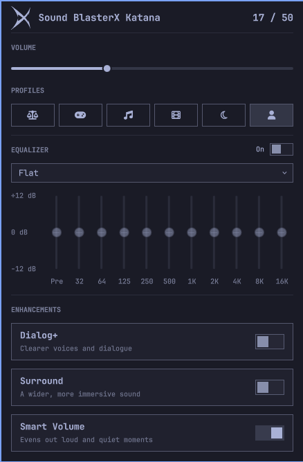

# Sound BlasterX Katana for Omarchy

Bar widget for the Creative Sound BlasterX Katana (USB `041e:3247`, the original Katana).
It keeps the system volume and the speaker's volume bar together, in both directions, and
lets you pick the Katana's stored sound profiles from a panel. No Windows, no Creative app.

> **Status.** Developed and tested on one original Katana. Unofficial, not affiliated with
> Creative. Volume sync and profile selection are verified on hardware; the protocol was
> worked out by observation and from community notes, so other firmware may differ.

## What it does

- **Volume sync.** Each point of the Katana's bar (0-50) is 2% of the system volume. The
  speaker's buttons set the system volume; changing the volume on the PC moves the bar.
  PipeWire's software gain is pinned to 1.0 so the Katana's amplifier does the attenuation.
- **Profiles.** Select the six profiles stored in the speaker, shown as icons. A change made
  on the speaker is announced on screen.
- **Equalizer.** A 10-band equalizer (32 Hz to 16 kHz, +-12 dB, plus a preamp) with twelve
  presets and one personal profile that keeps your last manual setting. It runs on the PC as a
  PipeWire filter in front of the Katana, so it does not touch the speaker's own profiles.
  Turning it off hands the default output back to the Katana.

## Requirements

- Omarchy (Quickshell shell), `python3`, PipeWire (`pipewire`, `pactl`, `pw-cli`, `pw-dump`) and `alsa-utils`.
- A udev rule so your user can open the Katana's HID interfaces:

      sudo cp udev/71-katana-hidraw.rules /etc/udev/rules.d/
      sudo udevadm control --reload && sudo udevadm trigger --subsystem-match=hidraw

## Install

    omarchy plugin add https://github.com/borferkic/katana-omarchy --enable

then `omarchy bar move io.github.borferkic.katana --section right`.

## Remove

    omarchy plugin remove io.github.borferkic.katana

That stops the volume sync and the equalizer, and gives the default output back to the Katana.
Two things stay on purpose, delete them if you want a clean system:

    sudo rm /etc/udev/rules.d/71-katana-hidraw.rules   # the HID access rule from Install
    rm -r ~/.config/katana-omarchy ~/.cache/katana-omarchy   # your equalizer settings and cached state

## What it changes on your system

Only while the plugin is enabled, and only for the Katana:

- Volume sync sets the system volume of the Katana's sink and the speaker's own volume (the ALSA
  `Speakers` control) so the two match, and pins PipeWire's software gain on that sink to 1.0.
  Turn it off with the `syncVolume` setting.
- Selecting a profile writes it to the speaker, which keeps it.
- Turning the equalizer on starts a PipeWire filter and makes it the default output, only if the
  Katana was the default. Turning it off, or stopping the plugin, restores the Katana.
- It writes `~/.config/katana-omarchy/eq.json` and `~/.cache/katana-omarchy/state.json`, and
  nothing else in your configuration.

## Usage

| Input | Action |
| --- | --- |
| Left click on the bar icon | Open the panel |
| Right click | Refresh |
| `Esc` / `r` | Close / refresh |
| Equalizer slider | Drag, scroll, or double-click to reset to 0 dB |

Settings: `syncVolume` (default on) and `announceProfile` (default on).

## How it works

`bin/katana.py` has these commands: `daemon` (volume sync and equalizer, one JSON event per
line, single instance), `status`, `profile N`, `volume N`, and `eq` / `eq set JSON`.

- The Katana reports its bar as `5a 23 03 00 <level>`: on HID interface 3 for the buttons,
  on interface 4 for changes made from the PC.
- The bar follows the ALSA `Speakers` control (0-128) through a non-linear curve, measured
  with a sweep and stored in the script.
- Profiles are selected with `5a 1a 03 00 02 <n>` on interface 4; the speaker acknowledges
  with `5a 1a 02 02 <n>`.

The equalizer settings live in `~/.config/katana-omarchy/eq.json`. The daemon watches that file,
runs `pipewire -c` with a stereo filter-chain (preamp plus one biquad per band: low shelf,
eight peaking bands, high shelf), retunes it live with `pw-cli`, and names the filter's output
stream so Omarchy's volume keys still resolve to the Katana itself.

## Development

The shell caches a plugin's QML while it runs: after editing a `.qml` file, run
`omarchy restart shell`. Keep the plugin as a real folder under `~/.config/omarchy/plugins/`;
the shell's file watcher does not follow symlinks.

## License

MIT
